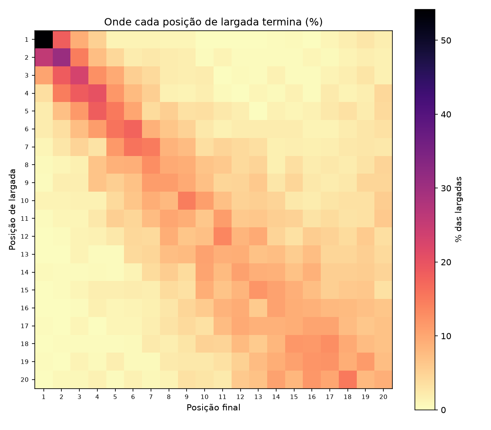
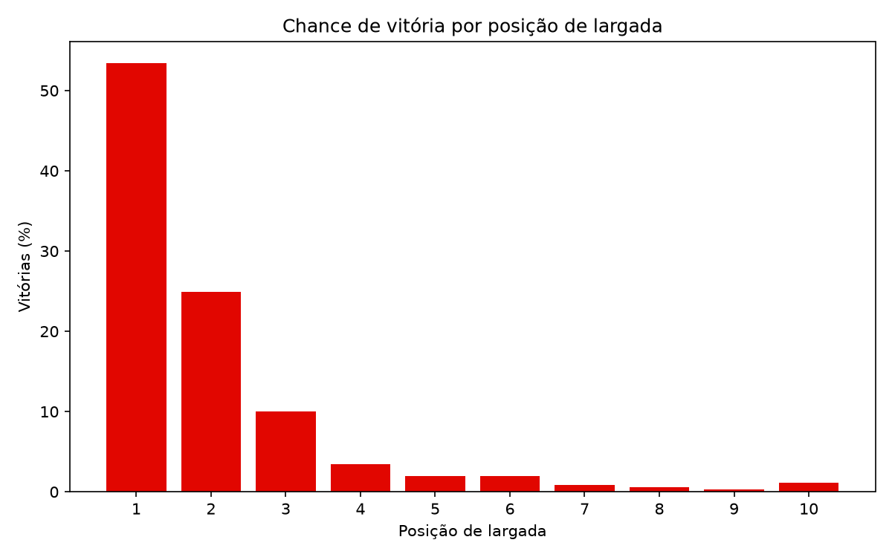
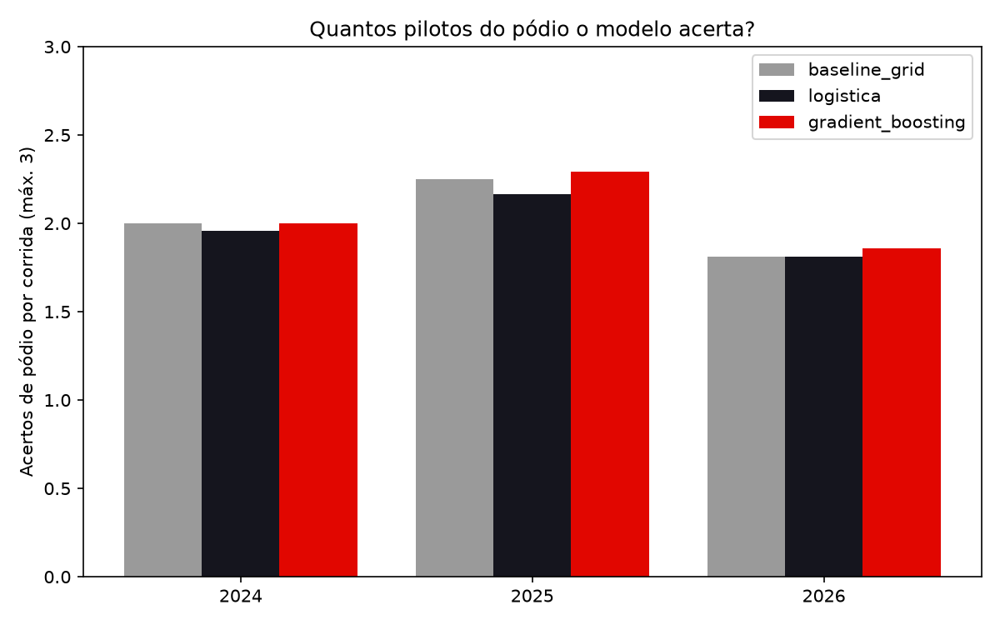
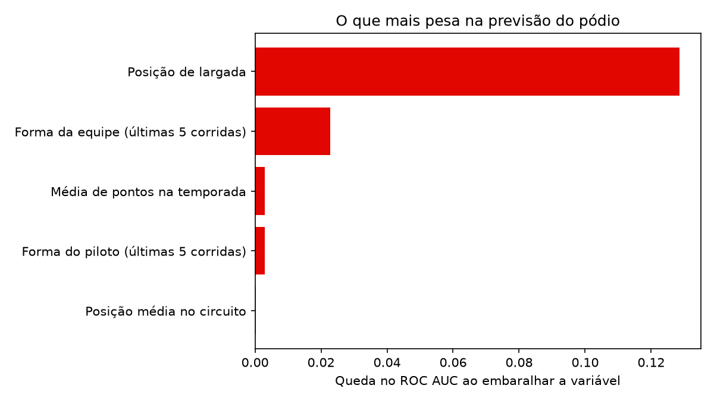
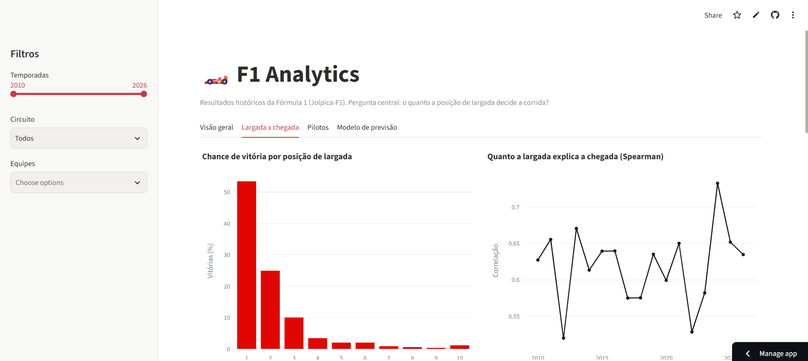

# 🏎️ F1 Analytics: o quanto a largada decide a corrida?

Pipeline de dados da Fórmula 1 que coleta resultados históricos, grava em um banco SQLite, analisa a relação entre posição de largada e chegada, treina um modelo para prever o pódio e apresenta tudo em um dashboard interativo.

**👉 [Abrir o dashboard](https://f1-analyticcssss.streamlit.app/)**



## Pergunta central

> Em uma corrida de F1, o quanto a posição de largada determina o resultado, e dá para prever o pódio melhor do que simplesmente apostar em quem larga na frente?

## Principais conclusões

Resultados de **2010 a 2026** (350 corridas):

- Saindo da pole, a chance de vitória é de **53,4%** e a de pódio é de aproximadamente **90,1%**.
- A correlação entre largada e chegada (Spearman) ficou em média em **0,62**, e **[ficou relativamente estável]** ao longo das temporadas.
- Circuitos onde a pole mais vira vitória: **[Park ZandVoort], [Yas Marina]**. Onde menos vira: **[Bahrain International]**.
- O modelo acertou em média **2,05 dos 3 pilotos do pódio por corrida**, contra **2,02** da regra "o pódio é quem larga na frente". **[Conclusão em uma frase: o modelo superou o baseline por aproximadamente 0,03 piloto por corrida , apresentando uma vantagem muito pequena. Isso indica que a posição de largada já explica grande parte da capacidade de previsão do pódio]**

<p>
  
  
</p>

## O que o projeto faz

```
API Jolpica-F1
   -> Extract   (requests, paginação e novas tentativas)
   -> Transform (pandas: JSON para tabela plana)
   -> Load      (SQLite, carga idempotente)
   -> Análise   (largada x chegada)
   -> Modelo    (previsão de pódio, avaliação por temporada)
   -> Dashboard (Streamlit + Plotly)
```

## Como rodar

```bash
git clone https://github.com/SEU-USUARIO/f1-analytics.git
cd f1-analytics
python -m pip install -r requirements.txt

python -m src.main --inicio 2010      # coleta os dados, grava no SQLite e gera a análise
python -m src.train                   # treina e avalia o modelo de pódio
streamlit run dashboard/app.py        # abre o dashboard
python -m pytest -q                   # roda os testes
```

Opções úteis:

- `python -m src.main --inicio 2018 --fim 2023` limita as temporadas coletadas.
- `python -m src.main --so-analise` refaz a análise sem coletar de novo.
- `python -m src.train --n-anos-teste 5` usa mais temporadas como teste.

## Estrutura

```
f1-analytics/
├── src/
│   ├── extract.py     # coleta na API Jolpica-F1
│   ├── transform.py   # JSON para tabela plana
│   ├── load.py        # SQLite (carga idempotente)
│   ├── analysis.py    # análise de largada x chegada e gráficos
│   ├── features.py    # variáveis do modelo (sem vazamento de dados)
│   ├── model.py       # modelos e avaliação walk-forward
│   ├── train.py       # treino, métricas e gráficos do modelo
│   └── main.py        # coleta + análise
├── dashboard/app.py   # dashboard Streamlit
├── tests/             # testes com pytest
├── data/f1.db         # banco SQLite
└── reports/           # métricas e figuras geradas
```

## Metodologia

### Dados

Resultados de corridas desde **2010**, obtidos da API Jolpica-F1: uma linha por piloto por corrida, com largada, posição final, pontos, voltas e status. A carga é idempotente: rodar a coleta duas vezes não duplica registros.

### Análise de largada x chegada

- Chance de vitória por posição de largada.
- Correlação de Spearman entre largada e chegada, por temporada.
- Matriz de onde cada posição de largada termina.
- Ranking de circuitos pela taxa de vitória saindo da pole (com 5 ou mais corridas).

### Modelo de previsão de pódio

**Alvo:** o piloto terminou entre os 3 primeiros (sim ou não).

**Variáveis**, todas conhecidas antes da largada:

| Variável | Descrição |
|---|---|
| Posição de largada | Largada dos boxes vira "último + 1" |
| Forma do piloto | Média de pontos nas 5 corridas anteriores |
| Forma da equipe | Média de pontos por carro nas 5 corridas anteriores |
| Média de pontos na temporada | Só das corridas já disputadas |
| Posição média no circuito | Histórico do piloto naquele circuito |

**Cuidados de método:**

- **Sem vazamento de dados:** todas as variáveis de forma usam apenas corridas anteriores. Um teste automatizado altera o resultado de uma corrida e confirma que as variáveis dela não mudam.
- **Divisão temporal (walk-forward):** para cada temporada de teste, o modelo é treinado só com temporadas anteriores, sem nunca olhar o futuro.
- **Baseline honesto:** os modelos são comparados com a regra "o pódio é quem larga na frente".

**Modelos:** regressão logística e gradient boosting (`HistGradientBoostingClassifier`, com parâmetros conservadores).

**Métricas:**

- **Acertos por corrida:** em média, quantos dos 3 pilotos de maior probabilidade realmente subiram ao pódio (de 0 a 3).
- **ROC AUC** e **precisão média**, que medem a qualidade do ranking de probabilidades.

### Resultados do modelo

Média nas temporadas de teste (**AAAA a AAAA**):

| Modelo | Acertos por corrida | ROC AUC | Precisão média |
|---|---|---|---|
| Baseline (largada) | X,XX | 0,XXX | 0,XXX |
| Regressão logística | X,XX | 0,XXX | 0,XXX |
| Gradient boosting | X,XX | 0,XXX | 0,XXX |



**[Interpretação em 2 ou 3 frases: qual variável mais pesa, se o modelo supera o baseline e por quanto.]**

## Dashboard

O dashboard permite filtrar por temporada, circuito e equipe, e tem quatro abas: visão geral, largada x chegada, pilotos e modelo de previsão.



## Limitações

- A posição final inclui abandonos, classificados pelo número de voltas completadas.
- Largadas dos boxes (grid = 0) ficam fora da análise de largada.
- O sistema de pontos mudou ao longo da história, por isso a coleta começa em AAAA, quando as regras passaram a ser mais consistentes.
- O modelo não enxerga clima, estratégia, quebras ou evolução do carro durante a temporada.
- O modelo foi avaliado em poucas temporadas, então diferenças pequenas entre modelos podem ser ruído.
- O projeto prevê o pódio com base em dados históricos, mas não prevê corridas futuras.

## Próximos passos

- Telemetria com FastF1 para comparar voltas de classificação.
- Incluir clima e dados de estratégia (pit stops e pneus).
- Automatizar a atualização dos dados a cada corrida com GitHub Actions.

## Fonte dos dados e créditos

Dados da [Jolpica-F1](https://github.com/jolpica/jolpica-f1), API compatível com o antigo Ergast. Este é um projeto independente de estudo e **não tem qualquer relação com a Fórmula 1 ou seus detentores de marca**.

## Autor

**[Isa Rosa]** · [LinkedIn](www.linkedin.com/in/isaarosa) · [GitHub](https://github.com/isaarosaDEV)
